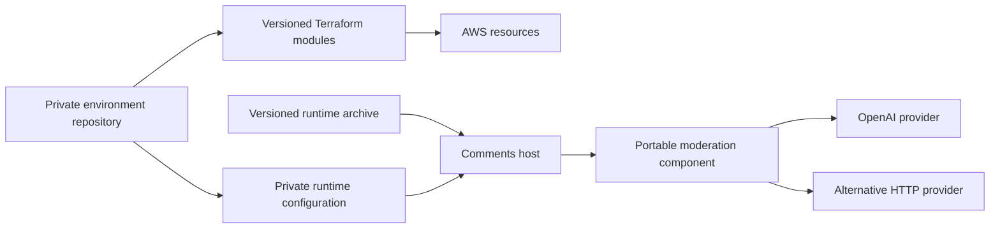
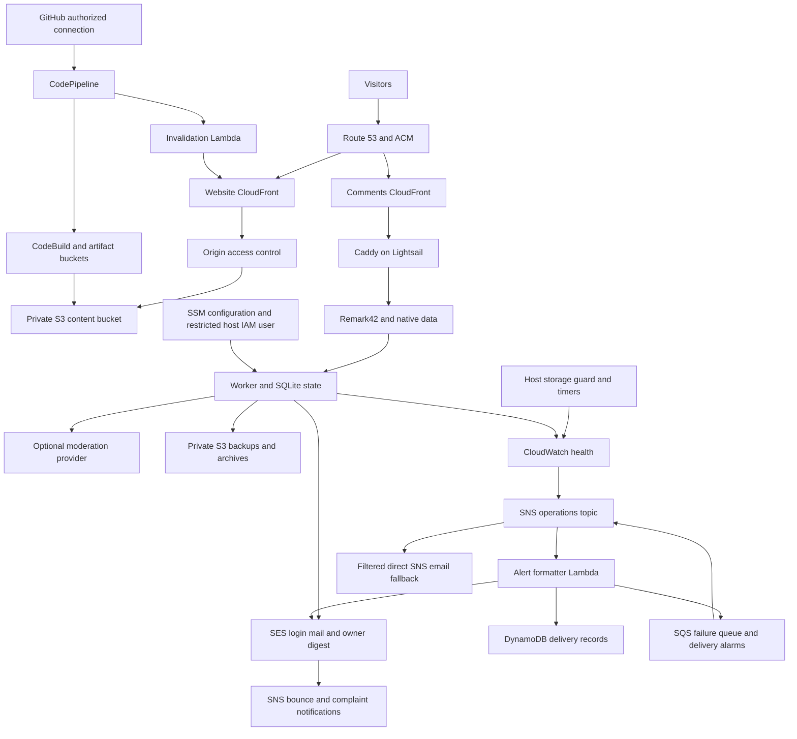
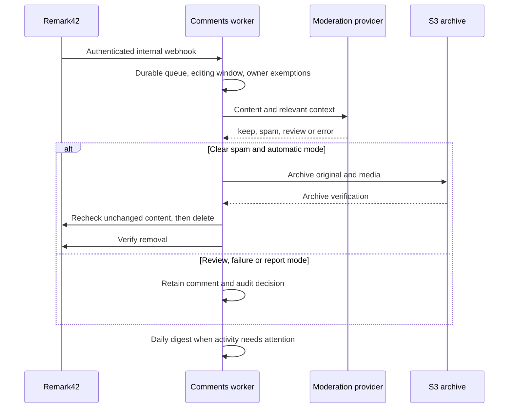

# Architecture and ownership

CloudFront checks an origin credential; Caddy blocks public automation/recovery
access and trusts only current CloudFront peers. The moderator has internal
Remark42 administration access. Providers receive content but no admin credentials.
Alert formatting runs independently of the host, and direct SNS fallback bypasses
both SES and Lambda.
